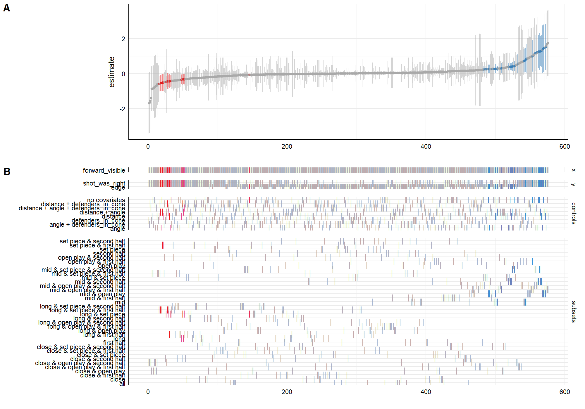

# Should they have passed?

When a player shoots, could we tell from the positional data that passing was
the better option? And more to the point: how much does the answer depend on
choices the analyst made along the way and never wrote down?

Built on StatsBomb's open data for the 2023 Women's World Cup. All 64 matches,
1,566 shots with penalties excluded, and a freeze frame for every one of them
giving the positions of the players the broadcast camera could see.

## What came out of it

Deciding whether a shot was the right call takes four further decisions. Which
teammates count as a real option. How likely a pass is to arrive. Whether the
receiver is valued using positional context or on distance alone. How much
better the alternative has to be before you call the shot wrong.

Run all 36 combinations and the share of shots where shooting beat the best
available alternative lands anywhere between 31.7% and 46.3%. Every one of those
specifications is defensible. None of them is wrong.

The ranking is the part I did not expect:

| Decision | Moves the answer by |
| --- | --- |
| Which teammates count as an option | 7.7 points |
| How large an edge counts as an edge | 4.5 points |
| Chance the pass arrives | 1.9 points |
| Whether the receiver gets positional context | 0.3 points |

The last one is the term with the significant coefficient behind it, the one
that would get a paragraph in a write-up. It barely touches the headline. The
first one is a single line of filtering that nobody would think to mention.

Holding a specification fixed and resampling the shots gives a 95% interval 4.8
points wide. The spread across specifications is 14.6, just over three times
larger. The error bar that gets published is the smaller of the two.

That is not a general law, and I have a counterexample in my own working: on a
simpler counting question over the same tournament the two came out about equal.
Which is the argument for running the specifications rather than reasoning about
them.

## Then I checked the model against what it had not seen

The passes players actually made, tracking data, and the footage of the shots
the model was surest about. That turned up seven fixes. The ones that settle a
question go in for good. The ones where reasonable people could still disagree
became branches. `analysis/05-fixes.R` applies them one at a time to a middle
specification:

| Step | Shooting was right | Change |
| --- | --- | --- |
| As submitted | 38.4% | |
| Drop direct free kicks | 39.1% | +0.7 |
| Offside options removed | 44.4% | +5.3 |
| Keeper off the line | 46.7% | +2.3 |
| What a miss or a bad pass still leads to | 44.6% | -2.1 |
| Completion measured on tracking | 57.3% | +12.7 |
| Cutbacks and lay-offs | 51.2% | -6.1 |
| Space, with defenders closing in | 47.8% | -3.4 |

## The 96

After the fixes there are five calls, not four. Which teammates count as an
option, now four ways with the cutbacks. How likely a pass is to arrive, three
ways, one of them measured. Whether the receiver gets positional context. How
large an edge counts as an edge. And whether a corner won from a miss is worth
the flat average or this team's own rating. 4 x 3 x 2 x 2 x 2 is 96, run on
1,526 shots once the direct free kicks are out.

The share of shots where shooting was right now runs from 19.7% to 66.1%. The
bootstrap interval is still about 5 points wide, so the calls outweigh the luck
by about 9 to 1 where it was 3 to 1.

| Decision | Moves the answer by |
| --- | --- |
| Which teammates count as an option | 19.2 points |
| How large an edge counts as an edge | 11.0 points |
| Chance the pass arrives | 10.1 points |
| Whether the receiver gets positional context | 0.8 points |
| Flat or team corner value | 0.1 points |

Same order at the top as before. The filtering line still matters most.

## The shot model

Distance to goal, the angle the goalmouth subtends, and how many defenders are
standing inside the triangle between the ball and the posts. That third term is
what the freeze frames buy, and it holds up: significant at p = 0.0013, and the
likelihood ratio test against the two-term model gives p = 0.00036.

It predicts a mean scoring rate equal to the observed 0.0837 and correlates 0.72
with the xG StatsBomb ship alongside the data, which is close enough for a
three-term model fitted on one tournament.

The fixes added two things. How far the keeper stands off the line, with a flag
for frames where the camera missed them: AIC down 12.3, and goals roughly double
once the keeper is four yards out. And the space around the shooter, capped at
10 yards: +0.22 a yard, p = 0.0005. It stays a logistic regression on purpose.
To value a pass it has to price a shot from where the receiver is standing,
where nobody actually shot, and a small model does that sensibly and can be
read.

## The decision score

The same machinery, turned on the player. For every shot, was a better pass
on? A player's should-have-passed share mostly says where they shoot from, so
the score is that share less what a typical player shooting from the same
spots would show: distance, angle and headers, as a second model. Below zero
is the better decider. Read it against players in the same position.

It runs on the event freeze frames that come with every shot, not the 360
frames, so it works on every league and tournament in the open data. On all
32,999 women's shots with a frame, 13 competition-seasons, on the model after
every fix:

| | |
| --- | --- |
| Split-half, players with 40+ shots | 0.69 |
| One season against the next, 51 pairs | 0.71 |
| Shots before a score can be trusted (0.7) | about 38 |
| Split-half within position | 0.43 |
| Shots to trust it within position | about 109 |

Finishing, goals minus xG, needs about 880 shots on the same test. The
decision score is readable in a season.

The within-position line is the one to remember. Forwards come out as good
deciders and defenders as poor ones, partly just from where they stand, and
that difference is very stable. Separating two forwards from each other is
harder, and needs two or three seasons of shots rather than one.

The men's version, 18,960 shots from the Premier League and La Liga in
2015/16 and Leverkusen's 2023/24, agrees at 0.60 and needs about 50 shots.
One season per league, so there is no season to season test, and it is kept
separate from the women's rather than pooled.

`analysis/08-decision-score.R` writes `reports/decision-score.md` through the
same gate as the findings, and the player tables into `cache/`, which is not
committed.

## Running it

Needs R and `jsonlite`. `04` also needs `specr`, and `07` needs `multiverse`.

```r
source("analysis/01-build-shots.R")   # fetches ~500 MB on a cold start
source("analysis/02-multiverse.R")
source("analysis/03-findings.R")
source("analysis/04-visibility-curve.R")
```

The team corner ratings come from every women's match in the open data, so they
are a step of their own, run once from the repository root before `05`:

```
python analysis/corners/pull.py
Rscript analysis/corners/ratings.R
```

```r
source("analysis/05-fixes.R")              # the fixes one at a time, then the 96
source("analysis/06-multiverse-fast.R")    # the 36 and the 96 again, without the loop
source("analysis/07-multiverse-package.R") # the 96 again, with the multiverse package
```

The decision score reads every shot in the open data, not just the World Cup,
so it has a pull of its own. About 1,300 women's matches and 800 men's are
downloaded once and only the shots kept:

```
python analysis/decision/pull.py          # both, or name one: women, men
Rscript analysis/08-decision-score.R      # about 7 minutes
```

The Python version, the boba run and the timings are in `python/`, with their
own README.

Tests:

```r
Rscript tests/testthat.R
```

## What is in here

| File | |
| --- | --- |
| `R/geometry.R` | Pitch geometry: goal angle, the shooting cone, clipping the camera's visible area |
| `R/statsbomb.R` | Reading the open data, and fetching it when it is missing |
| `R/features.R` | One row per shot, with the passing options visible at that instant |
| `R/value.R` | The shot model, the views of pass completion, the ways to decide what counts as an option, and what a miss or a failed pass still leads to |
| `R/multiverse.R` | Runs every combination of choices and reports which ones matter |
| `R/report.R` | Checks that every figure in the written findings is one the analysis produced |
| `R/decision.R` | The decision score: event freeze frames, the location model, the player table, and the reliability tests |
| `analysis/` | The scripts, in order, the team corner ratings in `analysis/corners/`, and the shot pull for the decision score in `analysis/decision/` |
| `python/` | The same analysis in Python, checked against R shot by shot, and the boba run |
| `reports/findings.md` | Generated, not hand-written |
| `reports/decision-score.md` | Generated, the same way |

## The gate on the write-up

`reports/findings.md` is produced by code, and the code will not write it if the
prose contains a number the analysis did not compute. Values that are not
results, like the year or the number of matches, have to be declared explicitly
rather than waved through, so that adding one is a deliberate act.

It sounds fussy. It exists because a wrong figure in a published summary is
much more expensive than a missing one, and checking by eye works right up until
the day it does not.

## The camera hypothesis, and how it died

The freeze frames only cover what was on screen. The area ahead of a shooter was
in frame a median of 69.6% of the time, so roughly 30% of the space a shooter might
have played into is missing from the record entirely.

That should bias the verdict. Less of the pitch visible means fewer options
recorded, means the best alternative is understated, means the shot looks more
justified than it was. Forward visibility does significantly predict how many
options get recorded, at p = 0.0034, so the censoring is real.

It does not reach the verdict. One regression put it at p = 0.218, which on its
own is not worth much, so this runs the question across 576 specifications with
`specr`: two outcomes, every subset of the geometry controls, and subsets by
shot distance, open play against set piece, and half.



The median coefficient is 0.009. Estimates run from -1.7 to 1.75, near enough
symmetric about zero. Only 10.1% of specifications are significant at 0.05,
barely above what chance would give you, and 46.9% point the way the hypothesis
predicted, which is a coin flip. Just 3.0% are both significant and in the
predicted direction.

The hypothesis is not just unsupported. It fails everywhere I looked, which is a
far more useful thing to be able to say than a single p value.

Two multiverses, doing different jobs. `specr` handles the model specification
side, which is what it was built for. `R/multiverse.R` handles the choices made
while constructing the numbers, which sit upstream of any model and which specr
does not cover. Those are what Steegen et al. (2016) called the data multiverse:
every version of the data that defensible processing choices could have produced.


## Where the method comes from

Running an analysis under every defensible version of its choices is not a new
idea. It is multiverse analysis (Steegen, Tuerlinckx, Gelman and Vanpaemel,
2016) and specification curve analysis (Simonsohn, Simmons and Nelson), both
well established in psychology and economics.

The most cited demonstration of the problem used football data. Silberzahn and
colleagues gave 29 analyst teams one dataset and asked whether referees give
more red cards to dark-skinned players. The teams reached materially different
answers from the same rows. "Many Analysts, One Data Set", 2018.

Football supplied the canonical example and football analytics then largely did
not adopt the response. That gap is what this repository is poking at.

There are packages for it. `analysis/07-multiverse-package.R` runs the 96 again
with `multiverse` (Sarma and Kay), which puts each choice on the line where it
is made, and `python/boba/` does the same with boba (Liu, Kale, Althoff and
Heer), which writes every version out as a script of its own. Both reproduce
all 96 answers exactly. Check their defaults the way you would check your own:
`multiverse` can run a step twice without saying so unless you set
`.execute_default = FALSE`, and boba reports success for a version that
crashed, so read its log. `specr` is the one to use when the choices are inside
the regression, which is why the camera test uses it. The calls here sit
upstream of any model. The harness in `R/multiverse.R` is still a deliberately
small thing, about seventy lines.

## Prior work on the football question

Whether a player should have shot or passed is a well studied problem, not a new
one. Yeung and colleagues frame 1-vs-1 shot-taking game-theoretically (2024).
Caldeira and colleagues model finishing space value for shooting decisions
(2024). Decroos opens his thesis on valuing actions with exactly this question.

What is different here is not the question. It is running the answer 36 times,
then 96.


## Limitations

Freeze frames carry no player identities, only a flag for teammate or opponent.
So the decision can be attributed to the player who took the shot, but the
teammate they should have found stays anonymous.

The camera only shows part of the pitch. The area ahead of the shooter was in
frame a median of 69.6% of the time, so about 30% of the space they might have
played into is simply absent. Counting the options available means counting the
options a broadcast director chose to frame. I tested whether that censoring bends the
verdict and it does not, which was not what I expected when I wrote the test.

Pass completion was the weakest part. Event data records a failed pass where it
was stopped, not where it was aimed, so it cannot be fitted on StatsBomb's own
passes. The measured version comes from SkillCorner's open A-League 2024/25
tracking: 850 passes from within 30 yards of goal, 68% complete, where the
assumed versions said 84 to 86%. Its coefficients are written into
`R/value.R`. That is men's football standing in for a women's tournament,
because there is no public women's tracking with the ball, which is why it is
one branch of three and not the only one.

One tournament, 1,566 shots. Wide enough for a spread, not wide enough for a law.

## Data

StatsBomb open data: https://github.com/statsbomb/open-data, which now lives at
https://github.com/hudl/open-data (the old address still serves the files)

Free for public use. If you publish anything based on it, credit StatsBomb as
the source. Nothing from it is committed here; the scripts fetch what they need.

SkillCorner open data, A-League 2024/25, for the pass completion model:
https://github.com/SkillCorner/opendata
